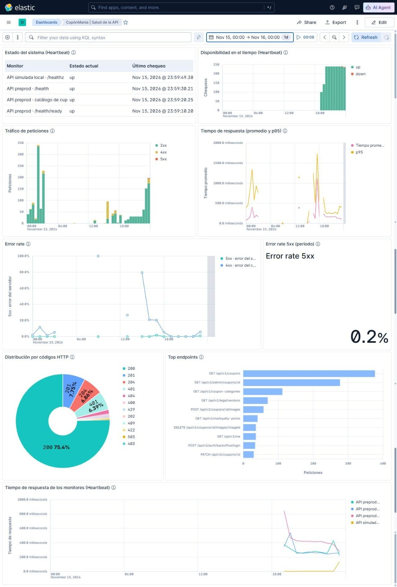

# Informe técnico — Fase 3: monitoreo de CupónManía con ELK

> **Borrador para revisión del equipo.** Las cifras de tráfico y latencia se cotejaron con los 1274 eventos exportados de CloudWatch del 2026-11-10 (ventana 15:47:53–16:07:53 UTC; 09:47:53–10:07:53 hora de Guatemala). La captura de Kibana usa un intervalo más amplio. El equipo debe revisar y poder explicar el informe antes de entregarlo.

## 1. Vía elegida y arquitectura

El equipo eligió la **API real de CupónManía en preproducción** (`https://api-preprod.cuponmania.com.gt`) como fuente de los logs. La API simulada del repositorio se conserva como alternativa local y se usa para la prueba controlada de caída de Heartbeat.

```text
Generador (traffic/) ──HTTPS──► Cloudflare ─► CloudFront ─► AWS Lambda (API, Bun)
                                                              │ una línea JSON ECS por petición
                                                              ▼
                                         CloudWatch Logs /aws/lambda/cuponmania-api-preprod
                                                              │ perfil AWS de solo lectura
                                                              ▼
                     Filebeat (aws-cloudwatch) ─────────► Elasticsearch ◄──── Heartbeat
                                                              │              (4 monitores HTTP)
                                                              ▼
                                         Kibana — dashboard «CupónManía | Salud de la API»
```

- **Stack:** Elasticsearch, Kibana, Filebeat y Heartbeat 9.5.5 en Docker Compose (`docker-compose.yml`), en la máquina del equipo. La guía de uso está en `docs/elk.md`.
- **Logs:** la API los escribe desde su propio código, una línea por petición terminada, en formato ECS 8.11. Incluyen los siete campos exigidos (`@timestamp`, `http.request.method`, `http.response.status_code`, `event.duration` en nanosegundos, `url.path`, `service.name`, `log.level`), además de `http.route`, `http.request.id` y el elemento del catálogo de la Fase 1 (`cuponmania.catalog_id`, `cuponmania.component`).
- **Filebeat:** entrada `aws-cloudwatch`. Decodifica el JSON de cada línea y descarta las líneas de plataforma de Lambda (START/END/REPORT). Usa la plantilla ECS de Filebeat, con lo que el código HTTP y la duración quedan numéricos y `@timestamp` como fecha.
- **Heartbeat:** cuatro monitores.
  - En la API real: `/health` (proceso y base de datos), `/health/ready` y el catálogo público de cupones.
  - En la API simulada local: `/healthz`.

## 2. Generador de tráfico y endpoints

`traffic/main.py --target real` recorre doce rutas: los ocho elementos del catálogo de la Fase 1 (INC-01 a INC-04, SR-01 a SR-04) y dos rutas públicas del catálogo de cupones.

- Envía las peticiones **sin sesión y con cuerpos vacíos**, de modo que no crea compras, canjes ni datos reales.
- Por eso los 4xx son el resultado esperado de la mayoría de rutas: la proporción de errores la determina la API real, no un parámetro del generador.
- Ejecución medida: `--rate 1 --concurrency 1 --duration 1200 --seed 42`.

| Resultado del generador (`evidencias/ejecucion-preprod.json`) | Valor |
| --- | ---: |
| Peticiones completadas | 1196 |
| 200 | 399 |
| 401 | 697 |
| 429 | 90 |
| 400 | 10 |
| Errores de transporte | 0 |

## 3. Evidencias

- `evidencias/api-preprod.log`: **1274 líneas** de acceso exportadas tal cual de CloudWatch para la ventana de la ejecución (generador y Heartbeat). El SHA-256 y el comando de exportación están en `evidencias/ejecucion-preprod.json`.
- `evidencias/capturas/dashboard-kibana.png`: el dashboard completo. El selector de tiempo visible abarca aproximadamente **09:40–10:15, hora de Guatemala** (15:40–16:15 UTC), unos 35 minutos. Incluye la ejecución de 20 minutos y eventos anteriores y posteriores; sus conteos no tienen por qué coincidir con los de la exportación de 20 minutos.
- Objetos de Kibana reproducibles: `elk/kibana/saved-objects.ndjson`, que se importan solos al levantar el compose.

### Capturas complementarias de Kibana — 15 de noviembre

El equipo añadió estas capturas de la validación local. Sus ventanas y filtros son distintos de los de la captura histórica y de los resultados de 20 minutos presentados arriba.

{ width=85% }

{ width=65% }

{ width=85% }

## 4. Resultados observados

Fuente para los conteos y la latencia siguientes: `evidencias/api-preprod.log`, exportación de eventos de acceso de `cuponmania-api` entre 15:47:53 y 16:07:53 UTC. El archivo contiene 1274 eventos: 1014 de negocio y 260 de `/health` o `/health/ready`. La captura de Kibana y las cifras de Heartbeat tienen ventanas distintas, indicadas por separado.

**Tráfico de negocio**, que excluye `/health` y `/health/ready` (INC-04): **1014 peticiones**.

| Código | Peticiones | Proporción |
| --- | ---: | ---: |
| 401 | 697 | 68.7 % |
| 200 | 218 | 21.5 % |
| 429 | 89 | 8.8 % |
| 400 | 10 | 1.0 % |
| 5xx | 0 | 0 % |

**Tiempo de respuesta medido por la API** (`event.duration`, tráfico de negocio):

| Estadístico | Valor |
| --- | ---: |
| Promedio | 5.4 ms |
| Mediana | 3.0 ms |
| p95 | 10.5 ms |
| p99 | 19.6 ms |
| Máximo | 260.1 ms |

Por ruta:
- Las que rechazan por falta de sesión (401) responden en unos 3 ms.
- Las que consultan la base: catálogo de cupones 12.6 ms y categorías 10.8 ms en promedio.

**Salud:** 260 peticiones a `/health` y `/health/ready`, todas 200, con 2.1 ms de promedio dentro de la API.

**Heartbeat** (15:36–16:10 UTC):

Los conteos siguientes son los reportados en la ejecución histórica. La captura conserva una vista de su comportamiento, pero el repositorio original no incluyó los documentos de Heartbeat de esa ventana; no se presentan como una reconsulta realizada en esta computadora.

| Monitor | up | down | Causa de los down | Tiempo medio del chequeo |
| --- | ---: | ---: | --- | ---: |
| API preprod · /health | 62 | 5 | 429, todos antes de las 15:47:42 | 368 ms |
| API preprod · /health/ready | 27 | 6 | 429, todos antes de las 15:47:42 | 405 ms |
| API preprod · catálogo | 27 | 6 | 429, todos antes de las 15:47:42 | 373 ms |
| API simulada · /healthz | 131 | 4 | sin respuesta (prueba de caída) | 3 ms |

## 5. Análisis

1. **No se observaron respuestas 5xx en la ventana medida.** El error rate (5xx sobre el tráfico de negocio registrado por la API) fue de **0 %**. Esto no demuestra disponibilidad de todas las compras o canjes: el tráfico no tenía sesión ni completó operaciones comerciales; tampoco incluye rechazos anteriores a la API.
   - Los 4xx no cuentan como falla del servicio. Los 401 son el control de autenticación funcionando ante peticiones sin sesión. Los 400 son validación de datos.
   - Por eso el dashboard grafica 5xx y 4xx por separado.
2. **Los 429 del tráfico de negocio son un control de seguridad, no saturación.** Los 89 corresponden a `/api/v1/account-recovery/request`, cuyo límite es de 5 solicitudes por cada 15 minutos para evitar abuso de la recuperación de cuentas. El generador recibió 90 respuestas 429 y la API registró 89; la diferencia es compatible con un rechazo de Lambda por concurrencia que no llega a la API (punto 3).
3. **Heartbeat detectó un límite de capacidad real.** La API corre con concurrencia reservada de 1 instancia en Lambda. Cuando los monitores disparaban en el mismo segundo, Lambda rechazaba la petición simultánea con 429 antes de que llegara a la API.
   - La bitácora del 10 de noviembre reportó 0 en los intervalos anteriores y 21 en `Throttles` de CloudWatch entre 15:15 y 15:45 UTC. El repositorio original no adjuntó la exportación de esa consulta; se distingue esta cifra reportada de los conteos verificables en el `.log` y de las evidencias nuevas.
   - Al escalonar los monitores (15:47:42 UTC), los down desaparecieron: ningún down de preprod después de esa hora.
   - Para atender peticiones simultáneas de usuarios hace falta más de una instancia. Eso requiere antes mover la idempotencia y los límites de tasa a un almacén compartido. Se dejó como mejora posterior.
4. **Las mediciones de cliente y servidor tienen alcances diferentes.** La ejecución histórica reportó unos 370–400 ms por chequeo de Heartbeat desde Guatemala, mientras la API registró 2.1 ms para `/health`. La diferencia es compatible con red, TLS y componentes intermedios, pero estas mediciones no permiten atribuir una duración específica a cada componente.
5. **La ejecución histórica reportó una caída controlada y recuperación.** Al detener la API simulada (15:48:00–15:49:10 UTC), se reportaron 4 chequeos down y el regreso a up al reiniciarla. Se conserva la captura; faltan los documentos exportados de Heartbeat de esa ventana para cotejar aquí esos conteos.

## 6. Limitaciones

- La ventana es corta (20 minutos) y el tráfico es sintético y sin sesión: no ejercita compras, canjes ni pagos reales. Los percentiles no son un SLA de producción.
- El laboratorio corre con la seguridad de Elastic desactivada y puertos solo en `127.0.0.1`.

### Comprobación en esta computadora — 15 de noviembre de 2026

Se conservan por separado las evidencias en [`evidencias/2026-11-15-validacion-local/`](../evidencias/2026-11-15-validacion-local/):

- `pruebas.txt`: **149 pruebas aprobadas**, una advertencia de deprecación de Starlette/TestClient, en **32.03 s**, con Python 3.13.5. Incluye ocho regresiones nuevas del importador de Kibana.
- `validacion.json`: estados reales de Compose, Elasticsearch y Kibana; resultado de importación `success=true`, **11 objetos**, sin errores; conteos y SHA-256 de las muestras conservadas. Elasticsearch y Kibana pasaron sus healthchecks. El clúster Elasticsearch quedó `yellow` por una réplica no asignable al único nodo; sus primarios estaban activos.
- `heartbeat-consulta.json`: consulta y respuesta originales de Elasticsearch para **01:15:00–01:22:03 UTC del 16 de noviembre** (19:15:00–19:22:03 del día 15 en Guatemala). Contiene **37 chequeos up** de los cuatro monitores: 19 de la API simulada, 9 de `/health`, 4 de `/health/ready` y 5 del catálogo de preproducción. No hubo down en esta ventana; **no se repitió la caída controlada**.

Se abrió el dashboard en `http://localhost:5601`: los ocho paneles están presentes y los dos de Heartbeat muestran datos actuales. Los paneles de API muestran ausencia de resultados y avisos de campos ausentes porque **todavía no existen índices de Filebeat en este Elasticsearch**. La captura completa del 10 de noviembre se conserva como evidencia histórica; no se sustituye por una captura incompleta ni se atribuyen sus datos a esta computadora.

**Pendiente por acceso:** el usuario informó que AWS solicita contactar al administrador. No se completó el perfil SSO y Filebeat no se inició; no se verificó ingesta reciente de CloudWatch, sus tipos ni ausencia de duplicados tras reiniciar `lastSync`. Tampoco se ejecutaron en esta comprobación los cinco minutos de tráfico, la caída local de 45 segundos o una prueba de persistencia mediante reinicio. El equipo pidió limitar esta revisión a los entregables existentes; los pasos para retomar la validación están en `docs/elk.md`.

Al terminar esa primera comprobación, la demostración de ingesta en vivo seguía pendiente por SSO. La revisión final del informe por el equipo continúa pendiente.

**Actualización posterior del mismo día, 23:40 Guatemala (16 de noviembre, 05:40 UTC):** el usuario completó la autorización de AWS y se configuró `cuponmania-preprod` con `LecturaLogsPreprod`. Se verificaron `sts get-caller-identity` y lectura de CloudWatch mediante `filter-log-events`, ambos con salida 0, y se inició Filebeat. La consulta conservada en `evidencias/2026-11-15-validacion-local/ingesta-sso.json` encontró **8702 eventos de acceso** (`event.kind:event`, `service.name:cuponmania-api`), de los cuales **283** corresponden a los 15 minutos anteriores a la consulta. Los siete campos están presentes en todos esos eventos, sin errores de decodificación; `@timestamp` es fecha, código HTTP y duración son `long`, y los restantes campos obligatorios son `keyword`. Hay además logs de diagnóstico que no son eventos de acceso y no entran en los paneles de API.

Se recargó Kibana: los ocho paneles muestran datos, desaparecieron los avisos de campos faltantes y los cuatro monitores estaban up. El selector estaba en las últimas 24 horas; los datos incluyen peticiones ajenas a esta comprobación y no deben atribuirse a una nueva ejecución del generador. No se cambió código de aplicación ni se generó tráfico adicional con el script. Quedan pendientes la prueba de reinicio sin duplicados, la persistencia mediante reinicio y la nueva prueba controlada de caída; el bloqueo de acceso y la ingesta reciente **sí quedaron resueltos**.

### Pruebas finales del stack — 15 de noviembre, 23:47–23:55 Guatemala

Las tres pruebas solicitadas se ejecutaron contra los contenedores de esta computadora. Las consultas, documentos proyectados y comprimidos, comandos y capturas se conservan en [`evidencias/2026-11-15-pruebas-stack/`](../evidencias/2026-11-15-pruebas-stack/README.md). No se cambiaron la API, el generador, los paneles ni la configuración del stack para pasar estas pruebas.

| Prueba | Resultado observado |
| --- | --- |
| Caída controlada | API simulada detenida a las 05:48:11.359 UTC del 16 de noviembre; se solicitó su arranque tras **45.0003812 s** de espera medida. Heartbeat registró **up → down → up**, tres chequeos down y recuperación a las 05:49:08.562 UTC. Los seis chequeos de preproducción de esa ventana fueron up; no se detuvo preproducción. |
| Reinicio de Filebeat | **8755 documentos**, sus IDs, versiones y campos exportados permanecieron idénticos en una ventana cerrada. Se observó un evento de API posterior al arranque de Filebeat, ingerido después del reinicio. No aumentaron los IDs repetidos ni se reescribieron los documentos comparados. |
| Persistencia | Se detuvieron y recrearon Elasticsearch, Kibana, Filebeat y Heartbeat. Cambiaron sus IDs de contenedor y se conservaron `esdata` y `filebeatdata`. Los mismos **8755 documentos** y los **11 objetos de Kibana** persistieron sin ejecutar `kibana-setup`. Una nueva comparación, realizada después de reanudarse la ingesta, confirmó de nuevo el mismo hash y las mismas versiones. |

La comparación usa el intervalo **2026-11-10 00:00:00 UTC ≤ @timestamp < 2026-11-16 05:42:44.477401 UTC**, restringido a `event.kind:event` y `service.name:cuponmania-api`. No se compararon totales globales crecientes. Las proyecciones incluyen los siete campos obligatorios, identificador de petición, fecha de ingesta, `_index`, `_id` y `_version`. El hash canónico permaneció `93cd47507f0cbd4126dd2a8351cfd967f1bb7b4e1481dfaa6f49e3fc9ad98be8`.

**Calidad del origen:** antes del ensayo había 8735 identificadores de petición distintos entre los 8755 eventos. De los 20 pares repetidos, 19 presentan tiempos o datos diferentes; no se deben considerar automáticamente duplicados. Un par tiene mensajes idénticos: una consulta directa a CloudWatch confirmó que ambos eventos, con sus dos identificadores de origen, ya estaban allí. No se modificaron ni eliminaron. La conclusión es **sin nuevos duplicados en la ventana comprobada**, no que todo el histórico esté libre de duplicados.

Al finalizar, Elasticsearch y Kibana estaban saludables, Filebeat y Heartbeat activos y los cuatro monitores up con chequeos recientes. Había **8864 eventos de acceso**, 53 en los cinco minutos anteriores a la consulta de las 23:54:10 Guatemala, sin ausencia de campos obligatorios. Se verificaron visualmente los ocho paneles con datos y latencia en milisegundos. Las dos capturas nuevas (`dashboard-superior.jpg`, `dashboard-inferior.jpg`) son vistas complementarias de la ventana **Last 24 hours**; la captura histórica completa del 10 de noviembre permanece separada y no comparte estos conteos.

**Alcance para la presentación:** el entorno de esta computadora está técnicamente listo para demostrar el flujo CloudWatch → Filebeat → Elasticsearch → Kibana y Heartbeat. Se requiere conservar la sesión SSO vigente, tener Docker activo y que el equipo revise y pueda explicar el informe y la declaración de IA. No se probó un equipo distinto ni persistencia del archivo de logs de la API simulada al recrearla, pues no tiene volumen configurado; la API solo se detuvo y arrancó durante la prueba de caída. No se ejecutó una nueva sesión del generador en estos ensayos; sus pruebas y ejecuciones anteriores se mantienen identificadas por separado.

## 7. Uso de inteligencia artificial

**Actualización de integración del 16 de noviembre:** se incorporó la versión del equipo con nueve paneles y 12 objetos, p95, exclusión de `OPTIONS`, error rate por hora y latencia de Heartbeat. A solicitud del usuario, `kibana-setup` vuelve al script curl del equipo; el importador Python validado queda como herramienta local opcional. Las cifras y capturas anteriores conservan sus ventanas y la versión de ocho paneles que se comprobó entonces. Docker estaba apagado durante esta integración; queda pendiente comprobar aquí los nueve paneles con el importador curl. La resolución del merge y la adaptación de pruebas se realizaron con asistencia de Codex y `api_qa`, registradas en `docs/uso-de-ia.md`.

Ver `docs/uso-de-ia.md`.

- La API simulada, el generador, la instrumentación de la API real y el stack ELK se construyeron con asistencia de IA. Lo mismo vale para el compose, Filebeat, Heartbeat, Kibana y el dashboard, bajo la ampliación aprobada en persona por el catedrático, registrada en `docs/sources/aclaraciones-fase-3.md`.
- Este borrador de análisis también se redactó con IA, a partir de las cifras observadas que se citan.
- En la revisión local del 15 de noviembre, Codex corrigió los finales LF y la validación de importación, configuró `lastSync`, preparó la guía Windows, ejecutó Docker y pruebas, abrió Kibana y exportó evidencia. El intento inicial de SSO falló; posteriormente el usuario autorizó el acceso y se verificó ingesta real. Codex ejecutó las pruebas finales de caída, reinicio y persistencia; `api_qa` añadió las pruebas del importador, auditó las evidencias de los ensayos y documentó los resultados. Se conserva el registro de ambos momentos y de sus límites.
- Codex incorporó al apartado de evidencias tres capturas de Kibana aportadas por el equipo y añadió sus pies de figura; no cambió las cifras ni el análisis.
- El equipo revisa, ejecuta y debe poder explicar cada parte.
